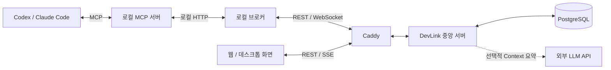

<div align="center">

<a href="https://about.devlink.ai.kr/">
  
</a>

# DevLink Server

**각자의 AI Agent를 연결해, 팀의 작업과 맥락을 이어갑니다.**

작업 요청·대화·결과를 저장하고, 팀의 Agent와 개발 맥락을 연결하는 중앙 서버입니다.

[](https://github.com/SSAFY-URAYAHA/DevLink_server/actions/workflows/ci-cd.yml)
[](LICENSE.txt)


[English](README.md) · **한국어**

[빠른 시작](#빠른-시작) · [사용 예시](#사용-예시) · [동작 구조](#동작-구조) · [설정](#설정) · [문서](#문서) · [라이선스](#라이선스)

</div>

## 소개

DevLink는 팀원들이 사용하는 AI 코딩 도구 사이에서 작업 요청과 개발 맥락을 전달하는 오픈소스 협업 도구입니다.

프론트엔드 개발자가 Codex를, 백엔드 개발자가 Claude Code를 사용하더라도 각자의 개발 환경에서 상대 Agent에게 작업을 요청하고 질문·답변·진행 상황·결과를 같은 작업 안에서 확인할 수 있습니다. 역할 태그와 Git 활동을 바탕으로 담당자 후보를 찾고, 다른 파트의 공유 사항과 미해결 쟁점도 조회합니다.

이 저장소는 **인증, 사용자·팀·Agent 관리, 작업 저장·전달, Git API, 담당 Agent 추천과 팀 Context**를 제공합니다. 로컬 브로커·CLI·MCP 서버는 [클라이언트](https://github.com/SSAFY-URAYAHA/DevLink_client), 협업 화면과 Electron 앱은 [프론트엔드·데스크톱 앱](https://github.com/SSAFY-URAYAHA/DevLink_frontend) 저장소에서 관리합니다.

로컬 코드 분석·수정·테스트는 사용자의 AI 도구가 수행하며, 중앙 서버는 협업 요청과 이력을 저장하고 전달합니다.

## 주요 기능

- **사용자·팀·Agent 관리** — 가입·로그인, 팀 생성·초대·참여, Agent 등록과 연결 토큰 발급을 제공합니다.
- **작업 요청과 결과 공유** — 작업 생성·상태 변경·완료 결과, 질문·답변과 이벤트 이력을 저장합니다.
- **실시간 전달과 재연결** — 브로커 WebSocket과 ACK, Outbox 재시도로 전달을 관리하고, 미전달 작업 재전송과 메시지 동기화를 지원합니다.
- **웹 조회와 변경 알림** — 팀 전체 작업 목록, 작업 상세·대화 이력 조회와 SSE 변경 알림을 제공합니다.
- **Git·파일 데이터 연동** — Git 신원을 검증하고, 커밋 배치·현재 작업 파일·파일 의존성 데이터를 반영합니다.
- **담당 Agent 추천** — 역할 태그와 커밋·현재 작업 파일의 근거를 점수화하고 후보의 접속 상태를 함께 제공합니다. 요청 대상은 사용자가 선택합니다.
- **팀 Context 관리** — 파트 간 공통 맥락·달라진 맥락·주요 쟁점을 저장하며, 선택적으로 외부 LLM 요약을 사용합니다.
- **작업 파일 갱신 충돌 방지** — revision과 `If-Match`를 이용해 늦게 도착한 이전 요청이 최신 목록을 덮어쓰는 것을 방지합니다.

## 사용 예시

서버 실행과 팀·Agent 등록을 마친 뒤 사용할 수 있는 REST API 예시입니다. 아래 코드는 Bash 기준이며 `curl`이 필요합니다. 팀 ID, 수신 Agent ID와 토큰은 실제 발급·조회한 값으로 변경합니다.

회원가입·로그인부터 팀·Agent 생성까지 순서대로 실행하는 PowerShell 예시는 [서버 API 실습](docs/server-api-quickstart.md)을 참고하세요.

**1. 요청 Agent의 인증 정보와 작업 대상을 지정합니다.**

```sh
api_base='http://localhost:8080/api/v1'
team_id=1
receiver_agent_id=2
agent_token='<요청 Agent의 연결 토큰>'
```

**2. 백엔드 Agent에게 API 분석 작업을 요청합니다.**

```sh
request_key="readme-demo-$(date +%s)"
curl -i -X POST "$api_base/tasks/$team_id" \
  -H "Authorization: Bearer $agent_token" \
  -H 'Content-Type: application/json' \
  --data-binary @- <<EOF
{
  "requestKey": "$request_key",
  "receiverAgentId": $receiver_agent_id,
  "taskSummary": "게시글 목록 API 응답 지연 분석",
  "prompt": "게시글 목록 조회가 느립니다. 관련 쿼리와 병목 원인을 분석하고 확인 결과를 알려주세요."
}
EOF
```

응답의 `data.taskId`로 작업을 식별하고 `data.delivery`에서 전달 결과를 확인합니다. 수신 Agent가 오프라인이면 작업이 저장되어도 즉시 실행되지 않습니다. 실제 협업을 진행하려면 수신자의 브로커·AI 도구가 연결되어 있어야 합니다.

같은 생성 요청을 재전송할 때는 동일한 `requestKey`와 본문을 사용합니다.

**3. 보낸 작업 목록과 결과를 확인합니다.**

```sh
curl "$api_base/teams/$team_id/tasks?scope=mine&direction=sent" \
  -H "Authorization: Bearer $agent_token"

# 위 생성 응답에서 받은 실제 taskId로 변경합니다.
task_id=1
curl "$api_base/tasks/$task_id" \
  -H "Authorization: Bearer $agent_token"
```

**4. 작업에 연결된 질문·답변 등의 이벤트 이력을 확인합니다.**

```sh
curl "$api_base/tasks/$task_id/events" \
  -H "Authorization: Bearer $agent_token"
```

웹 화면은 사용자 세션으로 인증하는 별도 조회 API를 사용합니다. 웹 목록에는 사용자가 소속된 팀의 전체 작업이 표시됩니다. 자세한 내용은 [작업 API](docs/task-api-design.md)와 [작업 메시지 동기화](docs/task-message-sync.md)를 참고하세요.

## 빠른 시작

### 1. 준비하기

- **Git**
- 실행 중인 **Docker Desktop 또는 Docker Engine**
- **Docker Compose v2** — `docker compose version`으로 확인
- 설치 명령에 사용할 **Bash + OpenSSL** 또는 **Windows PowerShell 5.1 이상 / PowerShell 7 이상**

아래 Docker 실행 방식은 호스트에 Java·Gradle·Node.js·Python·Rust를 설치할 필요가 없습니다. 서버를 로컬 JVM에서 실행하거나 소스 테스트를 수행하려면 **JDK 21**이 필요합니다.

### 2. 저장소와 환경 변수 준비

```sh
git clone https://github.com/SSAFY-URAYAHA/DevLink_server.git
cd DevLink_server
```

처음 복제한 저장소에서 아래 명령 중 자신의 환경에 맞는 하나를 실행합니다. `.env.example`을 복사하고 무작위 커서 서명키를 설정합니다.

macOS / Linux:

```sh
cursor_secret=$(openssl rand -hex 32)
sed "s/^TASK_MESSAGE_CURSOR_SECRET=.*/TASK_MESSAGE_CURSOR_SECRET=$cursor_secret/" .env.example > .env
unset cursor_secret
```

Windows PowerShell:

```powershell
$cursorKeyBytes = New-Object byte[] 32
$cursorKeyGenerator = [System.Security.Cryptography.RandomNumberGenerator]::Create()
$cursorKeyGenerator.GetBytes($cursorKeyBytes)
$cursorSecret = [Convert]::ToBase64String($cursorKeyBytes)
$cursorKeyGenerator.Dispose()
$localEnv = (Get-Content .env.example -Raw).Replace(
    'TASK_MESSAGE_CURSOR_SECRET=',
    "TASK_MESSAGE_CURSOR_SECRET=$cursorSecret"
)
[System.IO.File]::WriteAllText(
    (Join-Path (Get-Location) '.env'),
    $localEnv,
    [System.Text.UTF8Encoding]::new($false)
)
```

`TASK_MESSAGE_CURSOR_SECRET`는 32바이트 이상의 필수 서명키입니다. 비어 있거나 짧으면 서버가 시작되지 않습니다. 메시지 동기화 커서를 계속 검증할 수 있도록 재시작 후에도 같은 값을 유지합니다. 실제 인증 정보가 담긴 `.env`는 커밋하지 않습니다.

### 3. 서버와 DB 실행

```sh
docker compose up -d --build
docker compose ps
```

첫 실행 시 Docker 이미지 빌드와 Flyway DB 마이그레이션을 수행합니다. 서버 로그는 다음 명령으로 확인합니다.

```sh
docker compose logs -f app
```

### 4. 실행 확인

```sh
curl http://localhost:8080/api/v1/health
```

Windows PowerShell에서는 `curl.exe` 또는 다음 명령을 사용합니다.

```powershell
Invoke-RestMethod http://localhost:8080/api/v1/health
```

정상 응답:

```json
{
  "success": true,
  "data": "UP",
  "code": null,
  "message": null
}
```

| 대상 | 로컬 주소 |
| --- | --- |
| REST API | `http://localhost:8080/api/v1` |
| 브로커 WebSocket | `ws://localhost:8080/ws/broker` |
| 웹 SSE | `http://localhost:8080/api/v1/web/events` |
| PostgreSQL | `localhost:5432` |

종료할 때는 `docker compose down`을 사용합니다. DB 데이터는 Docker 볼륨에 유지됩니다.

### 5. 클라이언트와 화면 연결

1. [프론트엔드 문서](https://github.com/SSAFY-URAYAHA/DevLink_frontend)에 따라 화면을 실행하고 API 주소를 자신의 서버로 지정합니다.
2. `.env`의 `CORS_ALLOWED_ORIGINS`에 실제 프론트엔드 Origin을 지정합니다. 기본값에는 로컬 프론트엔드 주소가 포함되어 있지 않습니다.
3. 브로커의 Origin은 `WS_ALLOWED_ORIGINS`로 별도 설정하고 `docker compose up -d`로 설정을 반영합니다.
4. 사용자 가입·로그인, 팀 생성·참여, Agent 등록과 연결 토큰 발급을 진행합니다.
5. [클라이언트 문서](https://github.com/SSAFY-URAYAHA/DevLink_client)에 따라 연결할 중앙 서버 주소를 지정하고 브로커·MCP 서버를 AI 도구에 연결합니다.

로컬 API 실습은 [서버 API 실습](docs/server-api-quickstart.md), 실제 Agent 협업은 클라이언트 문서를 참고하세요.

## 동작 구조



Caddy는 HTTPS 배포 예시에서 인증서와 Reverse Proxy를 담당합니다. 빠른 시작의 로컬 Compose에서는 `localhost:8080`으로 앱에 직접 접근합니다.

| 구성 요소 | 역할 |
| --- | --- |
| REST API | 사용자·팀·Agent·작업·Git 데이터·추천·Context 요청 처리 |
| 브로커 WebSocket | Agent 접속 상태·Heartbeat와 작업·질문·답변 알림 전달 |
| 웹 SSE | 로그인한 사용자의 화면에 변경 알림 전달 |
| Outbox 처리기 | 업무 데이터와 전달 대기를 함께 저장하고 비동기 발행·재시도 수행 |
| PostgreSQL | 업무 데이터·이벤트·Outbox·Git·Context·revision 저장 |
| Context 갱신기 | 작업 이벤트를 바탕으로 파트 간 요약을 갱신하고 버전 관리 |

제공된 운영 배포 구성은 단일 앱 인스턴스 기준입니다. 여러 인스턴스로 확장하려면 세션·브로커 연결·웹 이벤트 전달을 공유하는 구성을 별도로 검토해야 합니다.

## 주요 API

사용자 API는 **세션 쿠키 + CSRF 토큰**, Agent 전용 REST API와 WebSocket은 **Bearer 토큰**으로 인증합니다. 사용자 변경 요청은 `/api/v1/auth/csrf`에서 발급받은 토큰을 전송하며, 로그인 후 토큰을 다시 조회합니다.

| 목적 | 주요 경로 |
| --- | --- |
| 인증 | `/api/v1/auth/signup`, `/api/v1/auth/login`, `/api/v1/auth/logout`, `/api/v1/auth/csrf` |
| 팀·Agent | `/api/v1/teams`, `/api/v1/agents/teams/{teamId}` |
| 작업 요청 | `POST /api/v1/tasks/{teamId}` |
| 상태·완료 | `PATCH /api/v1/tasks/{taskId}/status`, `POST /api/v1/tasks/{taskId}/complete` |
| 질문·답변 | `POST /api/v1/tasks/{taskId}/questions`, `POST /api/v1/tasks/{taskId}/answers` |
| Agent 작업 조회 | `/api/v1/teams/{teamId}/tasks`, `/api/v1/tasks/{taskId}`, `/api/v1/tasks/{taskId}/events` |
| 웹 작업 조회 | `/api/v1/web/teams/{teamId}/tasks`, `/api/v1/web/teams/{teamId}/tasks/{taskId}`, `/api/v1/web/teams/{teamId}/tasks/{taskId}/events` |
| 메시지 복구 | `GET /api/v1/agents/me/task-messages` |
| 커밋·작업 파일 반영 | `POST /api/v1/teams/{teamId}/git/commits:batch`, `PUT /api/v1/teams/{teamId}/git/working-files/{repoKey}` |
| 담당 Agent 추천 | `POST /api/v1/teams/{teamId}/agents/recommendations` |
| 팀 Context | `GET /api/v1/teams/{teamId}/context?part=BACKEND` |

입력·응답 필드는 [Controller](src/main/java/com/devlink/server/controller), [DTO](src/main/java/com/devlink/server/dto)와 아래 문서를 참고하세요. 일반 REST 응답은 `success`, `data`, `code`, `message` 형식을 사용하며 SSE·WebSocket은 별도 형식을 사용합니다.

## 설정

| 변수 | 용도 | 기본값·설정 기준 |
| --- | --- | --- |
| `DB_URL` | JDBC 주소 | 로컬 JVM은 `localhost:5432`, Compose는 내부 `postgres:5432` |
| `DB_USERNAME`, `DB_PASSWORD` | DB 인증 | 로컬 기본 `devlink`, 자체 배포 시 변경 |
| `TASK_MESSAGE_CURSOR_SECRET` | 메시지 커서 서명키 | 32바이트 이상, 필수 |
| `CORS_ALLOWED_ORIGINS` | REST 허용 Origin | 쉼표 구분, 자신의 웹 화면 주소 지정 |
| `WS_ALLOWED_ORIGINS` | WebSocket 허용 Origin | 로컬 기본 `http://localhost:3000` |
| `WORKING_FILES_REQUIRE_IF_MATCH` | 작업 파일 조건부 갱신 강제 | 기본 `false` |
| `UPSTAGE_API_KEY` | Context 추론 API 키 | 기본 비어 있음, 선택 |
| `TEAM_CONTEXT_INFERENCE_BASE_URL` | OpenAI 호환 API 주소 | 기본 `https://api.upstage.ai/v1` |
| `TEAM_CONTEXT_INFERENCE_MODEL` | 추론 모델 | 기본 `solar-pro4` |
| `TEAM_CONTEXT_INFERENCE_OPENROUTER_GUARD` | OpenRouter 제공자 필터 | 기본 `false` |

로컬 JVM은 `.env`를 읽고, Compose는 `app.environment`에 선언된 변수를 컨테이너로 전달합니다. 새 변수를 추가할 때는 Compose 전달 설정도 확인합니다. `WORKING_FILES_REQUIRE_IF_MATCH`는 운영 Compose에서 전달하며, 로컬 Compose에서 사용하려면 전달 설정을 추가합니다.

### 외부 LLM 요약 — 선택

기본 실행에는 외부 LLM API 키가 필요하지 않습니다. 키가 없으면 미답변 질문·실패·거절을 구조 기반으로 주요 쟁점에 반영하고, 공통 맥락·달라진 맥락은 기존 값을 유지합니다.

OpenRouter 설정 예시:

```dotenv
UPSTAGE_API_KEY=<자신의 OpenRouter API 키>
TEAM_CONTEXT_INFERENCE_BASE_URL=https://openrouter.ai/api/v1
TEAM_CONTEXT_INFERENCE_MODEL=openai/gpt-4o-mini
TEAM_CONTEXT_INFERENCE_OPENROUTER_GUARD=true
```

현재 키 변수 이름은 제공자와 관계없이 `UPSTAGE_API_KEY`입니다. 추론 입력에는 작업·이벤트 내용과 기존 요약 등이 포함되므로 제공자의 데이터 처리 정책을 확인하고 설정합니다.

요약은 이벤트 발생 후 비동기로 갱신하며, 조회 시에는 저장된 결과를 읽습니다. 외부 호출 실패 시 구조 기반 구현으로 자동 전환하지 않고 재시도합니다. 상세는 [팀 Context 문서](docs/team-context.md)를 참고하세요.

## 개발하기

로컬 JVM 실행과 소스 테스트에는 **JDK 21**과 실행 중인 **Docker**가 필요합니다. Gradle은 저장소의 Wrapper를 사용합니다.

빠른 시작에 따라 `.env`를 준비한 뒤 서버 컨테이너를 멈추고 DB만 실행합니다.

```sh
docker compose stop app
docker compose up -d postgres
./gradlew bootRun --args='--spring.profiles.active=local'
```

Windows PowerShell에서는 마지막 줄 대신 다음 명령을 사용합니다.

```powershell
.\gradlew.bat bootRun --args='--spring.profiles.active=local'
```

빌드·테스트:

```sh
./gradlew build
```

Windows는 `.\gradlew.bat build`를 사용합니다. 테스트만 실행하려면 `build` 대신 `test`를 사용합니다. 통합 테스트는 Testcontainers로 PostgreSQL 16을 별도로 실행하며 외부 LLM 키나 배포 Secrets 없이 수행할 수 있습니다.

- 실행 JAR: `build/libs/app.jar`
- 테스트 보고서: `build/reports/tests/test/index.html`
- 소스: `src/main/java/com/devlink/server`
- DB 마이그레이션: `src/main/resources/db/migration`

### 자체 배포

HTTPS 배포 예시는 [운영 Compose](deploy/docker-compose.prod.yml)와 [Caddy 설정](deploy/Caddyfile)에 있습니다. 이미지 주소·API 도메인·DB 인증·서명키·허용 Origin을 자신의 환경으로 변경합니다.

제공된 운영 구성은 Caddy의 80·443 포트를 외부에 노출하고 앱은 Compose 내부에서 연결합니다. DB 호스트 포트는 `127.0.0.1:5432`에 바인딩합니다. 배포용 환경 변수는 [운영 템플릿](deploy/.prod.env.example)을 참고하세요.

[CI/CD 워크플로우](.github/workflows/ci-cd.yml)는 빌드·테스트와 `master` push 시 GHCR·EC2 배포를 수행합니다. 이 자동 배포 경로를 사용하려면 이미지 주소와 배포 Secrets를 자신의 환경으로 구성해야 합니다.

## 문서

| 문서 | 내용 |
| --- | --- |
| [서버 API 실습](docs/server-api-quickstart.md) | PowerShell로 가입·로그인·팀·Agent 생성부터 작업 요청·조회까지 실행 |
| [사용자·팀·Agent](docs/auth-team-agent.md) | 인증·팀·Agent 관리 |
| [작업 API](docs/task-api-design.md) | 작업 요청과 상태·조회 API 설계 |
| [작업 생성·전달](docs/task-creation-implementation.md) | 생성·중복 검증·전달 흐름 |
| [질문·답변 알림](docs/task-message-notification.md) | 작업 대화와 알림 |
| [작업 메시지 동기화](docs/task-message-sync.md) | 재연결 후 메시지 복구 |
| [웹 SSE](docs/web-events.md) | 화면의 실시간 변경 알림 |
| [담당 Agent 추천](docs/agent-recommendation.md) | 후보 선정·점수·Git 근거 |
| [팀 Context](docs/team-context.md) | 요약 생성·저장·조회와 외부 LLM 설정 |

기능 문서는 작성 시점에 따라 현재 구현과 차이가 있을 수 있습니다. 실제 경로·인증·요청 필드는 Controller, Security 설정, DTO와 함께 확인하세요.

## 라이선스

DevLink Server는 [MIT 라이선스](LICENSE.txt)로 배포됩니다.

> Copyright (c) 2026 Lim Hyomin, Park Seongsu, Choi JunHyeok, Lee Jeongmin, JI Sanggeun, Choi Bogyeong

서버는 Spring Boot·Spring Security·Spring Data JPA, PostgreSQL, Flyway를 기반으로 하며, 테스트에 JUnit·Testcontainers, HTTPS 배포 예시에 Caddy를 사용합니다. 로고는 DevLink Frontend의 공용 이미지를 사용합니다. 외부 의존성과 로고에는 각 프로젝트의 라이선스·브랜드 정책이 적용됩니다.
