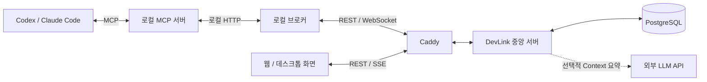

<div align="center">

<a href="https://about.devlink.ai.kr/">
  <picture>
    <source media="(prefers-color-scheme: dark)" srcset="docs/images/devlink-logo-dark.png">
    
  </picture>
</a>

# DevLink Server

**각자의 AI Agent를 연결해, 팀의 작업과 맥락을 이어갑니다.**

작업 요청·대화·결과를 저장하고, 팀의 Agent와 개발 맥락을 연결하는 중앙 서버입니다.

[](https://github.com/SSAFY-URAYAHA/DevLink_server/actions/workflows/ci-cd.yml)
[](LICENSE.txt)


[English](README.md) · **한국어**

[빠른 시작](#빠른-시작) · [사용 예시](#사용-예시) · [동작 구조](#동작-구조) · [문서](#문서) · [버그 제보](https://github.com/SSAFY-URAYAHA/DevLink_server/issues)

</div>

## 소개

DevLink는 팀원들의 AI 코딩 도구 사이에서 작업 요청과 개발 맥락을 전달하는 협업 도구입니다. Codex와 Claude Code에서 상대 Agent에게 작업을 요청하고 진행 상황과 결과를 확인할 수 있습니다.

이 저장소는 **인증, 사용자·팀·Agent 관리, 작업 저장·전달, Git API, 담당 Agent 추천과 팀 Context를 제공하는 중앙 서버**입니다. 로컬 코드 분석·수정·테스트는 사용자의 AI 도구가 수행하고, 서버는 협업 요청과 이력을 저장하고 전달합니다. 전체 서비스 소개와 데모는 [소개 페이지](https://about.devlink.ai.kr/)에서 확인할 수 있습니다.

## 주요 기능

- **사용자·팀·Agent 관리** — 가입·로그인, 팀 생성·초대·참여, Agent 등록과 연결 토큰 발급을 제공합니다.
- **작업 요청과 결과 공유** — 작업 생성·상태 변경·완료 결과, 질문·답변과 이벤트 이력을 저장합니다.
- **실시간 전달과 재연결** — 브로커 WebSocket과 ACK, Outbox 재시도로 전달을 관리하고, 미전달 작업 재전송과 메시지 동기화를 지원합니다.
- **웹 조회와 변경 알림** — 팀 전체 작업 목록, 작업 상세·대화 이력 조회와 SSE 변경 알림을 제공합니다.
- **Git·파일 데이터 연동** — Git 신원을 검증하고, 커밋 배치·현재 작업 파일·파일 의존성 데이터를 반영합니다.
- **담당 Agent 추천** — 역할 태그와 커밋·현재 작업 파일의 근거를 점수화하고 후보의 접속 상태를 함께 제공합니다. 요청 대상은 사용자가 선택합니다.
- **팀 Context 관리** — 파트 간 공통 맥락·달라진 맥락·주요 쟁점을 저장하며, 선택적으로 외부 LLM 요약을 사용합니다.
- **작업 파일 갱신 충돌 방지** — revision과 `If-Match`를 이용해 늦게 도착한 이전 요청이 최신 목록을 덮어쓰는 것을 방지합니다.

## 빠른 시작

### 1. 준비하기

- **Git**
- 실행 중인 **Docker Desktop 또는 Docker Engine**
- **Docker Compose v2** — `docker compose version`으로 확인
- 설치 명령에 사용할 **Bash + OpenSSL** 또는 **Windows PowerShell 5.1 이상 / PowerShell 7 이상**

아래 Docker 실행 방식은 호스트에 Java·Gradle·Node.js·Python·Rust를 설치할 필요가 없습니다. 서버를 로컬 JVM에서 실행하거나 소스 테스트를 수행하려면 **JDK 21**이 필요합니다.

### 2. 저장소와 환경 변수 준비

```sh
git clone https://github.com/SSAFY-URAYAHA/DevLink_server.git
cd DevLink_server
```

처음 복제한 저장소에서 아래 명령 중 자신의 환경에 맞는 하나를 실행합니다. `.env.example`을 복사하고 무작위 커서 서명키를 설정합니다.

macOS / Linux:

```sh
cursor_secret=$(openssl rand -hex 32)
sed "s/^TASK_MESSAGE_CURSOR_SECRET=.*/TASK_MESSAGE_CURSOR_SECRET=$cursor_secret/" .env.example > .env
unset cursor_secret
```

Windows PowerShell:

```powershell
$cursorKeyBytes = New-Object byte[] 32
$cursorKeyGenerator = [System.Security.Cryptography.RandomNumberGenerator]::Create()
$cursorKeyGenerator.GetBytes($cursorKeyBytes)
$cursorSecret = [Convert]::ToBase64String($cursorKeyBytes)
$cursorKeyGenerator.Dispose()
$localEnv = (Get-Content .env.example -Raw).Replace(
    'TASK_MESSAGE_CURSOR_SECRET=',
    "TASK_MESSAGE_CURSOR_SECRET=$cursorSecret"
)
[System.IO.File]::WriteAllText(
    (Join-Path (Get-Location) '.env'),
    $localEnv,
    [System.Text.UTF8Encoding]::new($false)
)
```

`TASK_MESSAGE_CURSOR_SECRET`는 32바이트 이상의 필수 서명키입니다. 비어 있거나 짧으면 서버가 시작되지 않습니다. 메시지 동기화 커서를 계속 검증할 수 있도록 재시작 후에도 같은 값을 유지합니다. 실제 인증 정보가 담긴 `.env`는 커밋하지 않습니다.

### 3. 서버와 DB 실행

```sh
docker compose up -d --build
docker compose ps
```

첫 실행 시 Docker 이미지 빌드와 Flyway DB 마이그레이션을 수행합니다. 서버 로그는 다음 명령으로 확인합니다.

```sh
docker compose logs -f app
```

### 4. 실행 확인

```sh
curl http://localhost:8080/api/v1/health
```

Windows PowerShell에서는 `curl.exe` 또는 다음 명령을 사용합니다.

```powershell
Invoke-RestMethod http://localhost:8080/api/v1/health
```

정상 응답:

```json
{
  "success": true,
  "data": "UP",
  "code": null,
  "message": null
}
```

| 대상 | 로컬 주소 |
| --- | --- |
| REST API | `http://localhost:8080/api/v1` |
| 브로커 WebSocket | `ws://localhost:8080/ws/broker` |
| 웹 SSE | `http://localhost:8080/api/v1/web/events` |
| PostgreSQL | `localhost:5432` |

종료할 때는 `docker compose down`을 사용합니다. DB 데이터는 Docker 볼륨에 유지됩니다.

웹 화면과 AI 도구를 이 서버에 연결하려면 [서버 연결 안내](docs/server-guide.ko.md#클라이언트와-화면-연결)를 참고하세요. 프론트엔드 Origin, 브로커 설정과 클라이언트 연결 절차를 안내합니다.

## 사용 예시

서버 실행과 팀·Agent 등록을 마친 뒤 사용할 수 있는 REST API 예시입니다. 아래 코드는 Bash 기준이며 `curl`이 필요합니다. 팀 ID, 수신 Agent ID와 토큰은 실제 발급·조회한 값으로 변경합니다.

회원가입·로그인부터 팀·Agent 생성까지 순서대로 실행하는 PowerShell 예시는 [서버 API 실습](docs/server-api-quickstart.md)을 참고하세요.

**1. 요청 Agent의 인증 정보와 작업 대상을 지정합니다.**

```sh
api_base='http://localhost:8080/api/v1'
team_id=1
receiver_agent_id=2
agent_token='<요청 Agent의 연결 토큰>'
```

**2. 백엔드 Agent에게 API 분석 작업을 요청합니다.**

```sh
request_key="readme-demo-$(date +%s)"
curl -i -X POST "$api_base/tasks/$team_id" \
  -H "Authorization: Bearer $agent_token" \
  -H 'Content-Type: application/json' \
  --data-binary @- <<EOF
{
  "requestKey": "$request_key",
  "receiverAgentId": $receiver_agent_id,
  "taskSummary": "게시글 목록 API 응답 지연 분석",
  "prompt": "게시글 목록 조회가 느립니다. 관련 쿼리와 병목 원인을 분석하고 확인 결과를 알려주세요."
}
EOF
```

응답의 `data.taskId`로 작업을 식별하고 `data.delivery`에서 전달 결과를 확인합니다. 수신 Agent가 오프라인이면 작업이 저장되어도 즉시 실행되지 않습니다. 실제 협업을 진행하려면 수신자의 브로커·AI 도구가 연결되어 있어야 합니다.

같은 생성 요청을 재전송할 때는 동일한 `requestKey`와 본문을 사용합니다.

**3. 보낸 작업 목록과 결과를 확인합니다.**

```sh
curl "$api_base/teams/$team_id/tasks?scope=mine&direction=sent" \
  -H "Authorization: Bearer $agent_token"

# 위 생성 응답에서 받은 실제 taskId로 변경합니다.
task_id=1
curl "$api_base/tasks/$task_id" \
  -H "Authorization: Bearer $agent_token"
```

**4. 작업에 연결된 질문·답변 등의 이벤트 이력을 확인합니다.**

```sh
curl "$api_base/tasks/$task_id/events" \
  -H "Authorization: Bearer $agent_token"
```

웹 화면은 사용자 세션으로 인증하는 별도 조회 API를 사용합니다. 웹 목록에는 사용자가 소속된 팀의 전체 작업이 표시됩니다. 자세한 내용은 [작업 API](docs/task-api-design.md)와 [작업 메시지 동기화](docs/task-message-sync.md)를 참고하세요.

## 동작 구조



Caddy는 HTTPS 배포 예시에서 인증서와 Reverse Proxy를 담당합니다. 빠른 시작의 로컬 Compose에서는 `localhost:8080`으로 앱에 직접 접근합니다.

### 관련 저장소

| 저장소 | 역할 |
| --- | --- |
| **DevLink_server — 현재 저장소** | 인증, 사용자·팀·Agent·작업 관리와 API·데이터 저장 |
| [DevLink_client](https://github.com/SSAFY-URAYAHA/DevLink_client) | CLI, 로컬 브로커, MCP 서버 |
| [DevLink_frontend](https://github.com/SSAFY-URAYAHA/DevLink_frontend) | 팀·작업 대시보드와 데스크톱 앱 |

## 문서

| 문서 | 내용 |
| --- | --- |
| [서버 설정과 배포](docs/server-guide.ko.md) | 클라이언트 연결, 주요 API, 환경 변수, 선택적 LLM 요약, JVM 개발과 자체 배포 |
| [서버 API 실습](docs/server-api-quickstart.md) | PowerShell로 가입·로그인·팀·Agent 생성부터 작업 요청·조회까지 실행 |
| [사용자·팀·Agent](docs/auth-team-agent.md) | 인증·팀·Agent 관리 |
| [작업 API](docs/task-api-design.md) | 작업 요청과 상태·조회 API 설계 |
| [작업 생성·전달](docs/task-creation-implementation.md) | 생성·중복 검증·전달 흐름 |
| [질문·답변 알림](docs/task-message-notification.md) | 작업 대화와 알림 |
| [작업 메시지 동기화](docs/task-message-sync.md) | 재연결 후 메시지 복구 |
| [웹 SSE](docs/web-events.md) | 화면의 실시간 변경 알림 |
| [담당 Agent 추천](docs/agent-recommendation.md) | 후보 선정·점수·Git 근거 |
| [팀 Context](docs/team-context.md) | 요약 생성·저장·조회와 외부 LLM 설정 |

기능 문서는 작성 시점에 따라 현재 구현과 차이가 있을 수 있습니다. 실제 경로·인증·요청 필드는 Controller, Security 설정, DTO와 함께 확인하세요.

소스 빌드와 검사·테스트는 [서버 개발 안내](docs/server-guide.ko.md#개발하기), 개발 참여와 PR 규칙은 [기여 가이드](CONTRIBUTING.ko.md)를 참고하세요.

## 기여하기

버그 제보, 문서 개선과 기능 제안을 환영합니다. [Issues](https://github.com/SSAFY-URAYAHA/DevLink_server/issues)에 재현 방법, 기대한 동작, 실제 동작과 사용 환경을 함께 남겨주세요. 로그를 첨부할 때는 비밀번호와 토큰을 제거해 주세요.

개발 참여와 브랜치·커밋·PR 규칙은 [기여 가이드](CONTRIBUTING.ko.md)를 참고하세요. 보안 취약점은 [보안 정책](SECURITY.ko.md)에 따라 제보해 주세요.

## 라이선스

DevLink Server는 [MIT 라이선스](LICENSE.txt)로 배포됩니다.

> Copyright (c) 2026 Lim Hyomin, Park Seongsu, Choi JunHyeok, Lee Jeongmin, JI Sanggeun, Choi Bogyeong

서버는 Spring Boot·Spring Security·Spring Data JPA, PostgreSQL, Flyway를 기반으로 하며, 테스트에 JUnit·Testcontainers, HTTPS 배포 예시에 Caddy를 사용합니다. 로고는 DevLink Frontend의 공용 이미지를 사용합니다. 외부 의존성과 로고에는 각 프로젝트의 라이선스·브랜드 정책이 적용됩니다.
