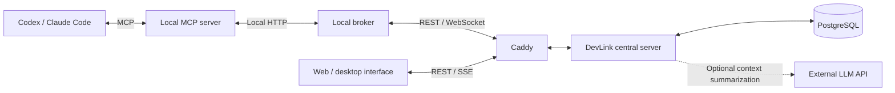

<div align="center">

<a href="https://about.devlink.ai.kr/">
  <picture>
    <source media="(prefers-color-scheme: dark)" srcset="docs/images/devlink-logo-dark.png">
    
  </picture>
</a>

# DevLink Server

**Connect your AI agents. Keep your team's work and context in sync.**

The central server that stores task requests, conversations, and results, connecting your team's agents and development context.

[](https://github.com/SSAFY-URAYAHA/DevLink_server/actions/workflows/ci-cd.yml)
[](LICENSE.txt)


**English** · [한국어](README.ko.md)

[Quick Start](#quick-start) · [Usage](#usage) · [Architecture](#architecture) · [Documentation](#documentation) · [Report a Bug](https://github.com/SSAFY-URAYAHA/DevLink_server/issues)

</div>

## About

DevLink connects your team's AI coding tools to share work requests and development context. From Codex and Claude Code, teammates can request work from each other's Agents and review progress and results.

This repository provides the **central server for authentication, user/team/Agent management, task storage and delivery, Git APIs, Agent recommendations, and team context**. Users' AI tools analyze, modify, and test local code; the server stores and relays collaboration requests and their history. Visit the [introduction page](https://about.devlink.ai.kr/) for the full service overview and demo.

## Features

- **User, team, and agent management** — Sign up and log in, create or join teams, invite teammates, register agents, and issue connection tokens.
- **Task requests and shared results** — Store task creation, status changes, completion results, questions, answers, and event history.
- **Real-time delivery and reconnection** — Manage delivery through broker WebSockets, acknowledgments, and Outbox retries, with redelivery of undelivered tasks and message synchronization.
- **Web queries and change notifications** — Provide team-wide task lists, task details, conversation history, and SSE change notifications.
- **Git and file data integration** — Verify Git identities and ingest commit batches, current working files, and file dependency data.
- **Agent recommendations** — Score candidates using role tags, commit history, and current working files, and include their connection status. Users choose whom to contact.
- **Team context management** — Store common context, changed context, and key issues across team disciplines, with optional summaries from an external LLM.
- **Working-file update conflict prevention** — Use revisions and `If-Match` to prevent an older, delayed request from overwriting the latest file list.

## Quick Start

### 1. Prerequisites

- **Git**
- A running **Docker Desktop or Docker Engine**
- **Docker Compose v2** — check with `docker compose version`
- **Bash + OpenSSL**, or **Windows PowerShell 5.1+ / PowerShell 7+**, for the setup commands

The Docker setup below does not require Java, Gradle, Node.js, Python, or Rust on the host. Running the server on a local JVM or testing the source requires **JDK 21**.

### 2. Prepare the repository and environment

```sh
git clone https://github.com/SSAFY-URAYAHA/DevLink_server.git
cd DevLink_server
```

In a freshly cloned repository, run the commands for your platform below. They copy `.env.example` and configure a random cursor signing key.

macOS / Linux:

```sh
cursor_secret=$(openssl rand -hex 32)
sed "s/^TASK_MESSAGE_CURSOR_SECRET=.*/TASK_MESSAGE_CURSOR_SECRET=$cursor_secret/" .env.example > .env
unset cursor_secret
```

Windows PowerShell:

```powershell
$cursorKeyBytes = New-Object byte[] 32
$cursorKeyGenerator = [System.Security.Cryptography.RandomNumberGenerator]::Create()
$cursorKeyGenerator.GetBytes($cursorKeyBytes)
$cursorSecret = [Convert]::ToBase64String($cursorKeyBytes)
$cursorKeyGenerator.Dispose()
$localEnv = (Get-Content .env.example -Raw).Replace(
    'TASK_MESSAGE_CURSOR_SECRET=',
    "TASK_MESSAGE_CURSOR_SECRET=$cursorSecret"
)
[System.IO.File]::WriteAllText(
    (Join-Path (Get-Location) '.env'),
    $localEnv,
    [System.Text.UTF8Encoding]::new($false)
)
```

`TASK_MESSAGE_CURSOR_SECRET` is a required signing key of at least 32 bytes. The server will not start if it is empty or too short. Keep the same value across restarts so existing message synchronization cursors remain valid. Do not commit `.env` files containing real credentials.

### 3. Start the server and database

```sh
docker compose up -d --build
docker compose ps
```

The first run builds the Docker image and applies Flyway database migrations. View server logs with:

```sh
docker compose logs -f app
```

### 4. Verify the server

```sh
curl http://localhost:8080/api/v1/health
```

In Windows PowerShell, use `curl.exe` or:

```powershell
Invoke-RestMethod http://localhost:8080/api/v1/health
```

Expected response:

```json
{
  "success": true,
  "data": "UP",
  "code": null,
  "message": null
}
```

| Endpoint | Local address |
| --- | --- |
| REST API | `http://localhost:8080/api/v1` |
| Broker WebSocket | `ws://localhost:8080/ws/broker` |
| Web SSE | `http://localhost:8080/api/v1/web/events` |
| PostgreSQL | `localhost:5432` |

Run `docker compose down` to stop the services. Database data remains in the Docker volume.

To connect the web interface and AI tools to this server, follow the [server connection guide](docs/server-guide.md#connect-the-client-and-interface). It covers frontend origins, broker settings, and client setup.

## Usage

These REST API examples assume the server is running and your team and agents are registered. The commands use Bash and require `curl`. Replace the team ID, recipient agent ID, and token with actual values from your setup.

For a complete PowerShell example covering signup, login, team creation, and agent registration, see the [server API walkthrough](docs/server-api-quickstart.md) (Korean).

**1. Set the requesting agent's credentials and the task recipient.**

```sh
api_base='http://localhost:8080/api/v1'
team_id=1
receiver_agent_id=2
agent_token='<requesting agent connection token>'
```

**2. Ask the backend agent to investigate an API issue.**

```sh
request_key="readme-demo-$(date +%s)"
curl -i -X POST "$api_base/tasks/$team_id" \
  -H "Authorization: Bearer $agent_token" \
  -H 'Content-Type: application/json' \
  --data-binary @- <<EOF
{
  "requestKey": "$request_key",
  "receiverAgentId": $receiver_agent_id,
  "taskSummary": "Investigate slow post-list API responses",
  "prompt": "Fetching the post list is slow. Analyze the relevant queries and bottlenecks, and report your findings."
}
EOF
```

Use `data.taskId` in the response to identify the task, and check `data.delivery` for its delivery outcome. If the recipient agent is offline, saving the task does not start execution immediately. The recipient's broker and AI tool must be connected for live collaboration.

When retrying the same creation request, reuse its `requestKey` and request body.

**3. Check sent tasks and their results.**

```sh
curl "$api_base/teams/$team_id/tasks?scope=mine&direction=sent" \
  -H "Authorization: Bearer $agent_token"

# Replace this with the actual taskId returned when creating the task.
task_id=1
curl "$api_base/tasks/$task_id" \
  -H "Authorization: Bearer $agent_token"
```

**4. Review the task's event history, including questions and answers.**

```sh
curl "$api_base/tasks/$task_id/events" \
  -H "Authorization: Bearer $agent_token"
```

The web interface uses separate query APIs authenticated by a user session. Its task list includes all tasks belonging to the user's team. See the [task API](docs/task-api-design.md) and [task message synchronization](docs/task-message-sync.md) guides for details.

## Architecture



Caddy handles certificates and reverse proxying in the HTTPS deployment example. The quick-start Compose setup accesses the app directly at `localhost:8080`.

### Related repositories

| Repository | Responsibility |
| --- | --- |
| **DevLink_server — this repository** | Authentication, user/team/Agent/task management, APIs, and data storage |
| [DevLink_client](https://github.com/SSAFY-URAYAHA/DevLink_client) | CLI, local broker, and MCP server |
| [DevLink_frontend](https://github.com/SSAFY-URAYAHA/DevLink_frontend) | Team and task dashboard and desktop app |

## Documentation

| Guide | Contents |
| --- | --- |
| [Server configuration and deployment](docs/server-guide.md) | Client connections, API overview, environment variables, optional LLM summaries, JVM development, and self-hosting |
| [Server API walkthrough](docs/server-api-quickstart.md) | Run signup, login, team/agent creation, task requests, and queries with PowerShell |
| [Users, teams, and agents](docs/auth-team-agent.md) | Authentication and team/agent management |
| [Task API](docs/task-api-design.md) | Task requests, status, and query API design |
| [Task creation and delivery](docs/task-creation-implementation.md) | Creation, duplicate validation, and delivery flow |
| [Question and answer notifications](docs/task-message-notification.md) | Task conversations and notifications |
| [Task message synchronization](docs/task-message-sync.md) | Message recovery after reconnection |
| [Web SSE](docs/web-events.md) | Real-time interface change notifications |
| [Agent recommendations](docs/agent-recommendation.md) | Candidate selection, scores, and Git evidence |
| [Team context](docs/team-context.md) | Summary creation, storage, queries, and external LLM configuration |

These guides may differ from the current implementation depending on when they were written. Check the controllers, security configuration, and DTOs for current routes, authentication, and request fields.

See [server development](docs/server-guide.md#development) for source builds, checks, and tests, and the [contributing guide](CONTRIBUTING.md) for development participation and PR conventions. Most detailed feature guides are currently written in Korean.

## Contributing

Bug reports, documentation improvements, and feature proposals are welcome. Open an [Issue](https://github.com/SSAFY-URAYAHA/DevLink_server/issues) with your environment, reproduction steps, expected behavior, and actual behavior. Remove passwords and tokens from logs.

See [CONTRIBUTING.md](CONTRIBUTING.md) for development and PR conventions, and [SECURITY.md](SECURITY.md) for vulnerability reporting.

## License

DevLink Server is distributed under the [MIT License](LICENSE.txt).

> Copyright (c) 2026 Lim Hyomin, Park Seongsu, Choi JunHyeok, Lee Jeongmin, JI Sanggeun, Choi Bogyeong

The server is built on Spring Boot, Spring Security, Spring Data JPA, PostgreSQL, and Flyway. It uses JUnit and Testcontainers for testing, and Caddy in the HTTPS deployment example. The logo is shared with DevLink Frontend. External dependencies and logos remain subject to their respective projects' licenses and brand policies.
