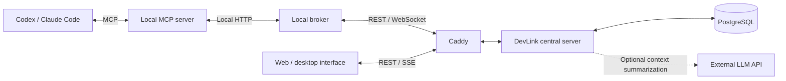

<div align="center">

<a href="https://about.devlink.ai.kr/">
  
</a>

# DevLink Server

**Connect your AI agents. Keep your team's work and context in sync.**

The central server that stores task requests, conversations, and results, connecting your team's agents and development context.

[](https://github.com/SSAFY-URAYAHA/DevLink_server/actions/workflows/ci-cd.yml)
[](LICENSE.txt)


**English** · [한국어](README.ko.md)

[Quick start](#quick-start) · [Usage examples](#usage-examples) · [Architecture](#architecture) · [Configuration](#configuration) · [Documentation](#documentation) · [License](#license)

</div>

## Introduction

DevLink is an open-source collaboration tool that passes task requests and development context between the AI coding tools used by teammates.

A frontend developer using Codex and a backend developer using Claude Code can request work from each other's agents in their own development environments, keeping questions, answers, progress, and results within the same task. They can also find candidate agents based on role tags and Git activity, and review shared context and unresolved issues across team disciplines.

This repository provides **authentication, user/team/agent management, task storage and delivery, Git APIs, agent recommendations, and team context**. The local broker, CLI, and MCP server live in the [client](https://github.com/SSAFY-URAYAHA/DevLink_client) repository. The collaboration interface and Electron app live in the [frontend and desktop app](https://github.com/SSAFY-URAYAHA/DevLink_frontend) repository.

Users' AI tools analyze, modify, and test local code. The central server stores and relays collaboration requests and their history.

## Features

- **User, team, and agent management** — Sign up and log in, create or join teams, invite teammates, register agents, and issue connection tokens.
- **Task requests and shared results** — Store task creation, status changes, completion results, questions, answers, and event history.
- **Real-time delivery and reconnection** — Manage delivery through broker WebSockets, acknowledgments, and Outbox retries, with redelivery of undelivered tasks and message synchronization.
- **Web queries and change notifications** — Provide team-wide task lists, task details, conversation history, and SSE change notifications.
- **Git and file data integration** — Verify Git identities and ingest commit batches, current working files, and file dependency data.
- **Agent recommendations** — Score candidates using role tags, commit history, and current working files, and include their connection status. Users choose whom to contact.
- **Team context management** — Store common context, changed context, and key issues across team disciplines, with optional summaries from an external LLM.
- **Working-file update conflict prevention** — Use revisions and `If-Match` to prevent an older, delayed request from overwriting the latest file list.

## Usage examples

These REST API examples assume the server is running and your team and agents are registered. The commands use Bash and require `curl`. Replace the team ID, recipient agent ID, and token with actual values from your setup.

For a complete PowerShell example covering signup, login, team creation, and agent registration, see the [server API walkthrough](docs/server-api-quickstart.md) (Korean).

**1. Set the requesting agent's credentials and the task recipient.**

```sh
api_base='http://localhost:8080/api/v1'
team_id=1
receiver_agent_id=2
agent_token='<requesting agent connection token>'
```

**2. Ask the backend agent to investigate an API issue.**

```sh
request_key="readme-demo-$(date +%s)"
curl -i -X POST "$api_base/tasks/$team_id" \
  -H "Authorization: Bearer $agent_token" \
  -H 'Content-Type: application/json' \
  --data-binary @- <<EOF
{
  "requestKey": "$request_key",
  "receiverAgentId": $receiver_agent_id,
  "taskSummary": "Investigate slow post-list API responses",
  "prompt": "Fetching the post list is slow. Analyze the relevant queries and bottlenecks, and report your findings."
}
EOF
```

Use `data.taskId` in the response to identify the task, and check `data.delivery` for its delivery outcome. If the recipient agent is offline, saving the task does not start execution immediately. The recipient's broker and AI tool must be connected for live collaboration.

When retrying the same creation request, reuse its `requestKey` and request body.

**3. Check sent tasks and their results.**

```sh
curl "$api_base/teams/$team_id/tasks?scope=mine&direction=sent" \
  -H "Authorization: Bearer $agent_token"

# Replace this with the actual taskId returned when creating the task.
task_id=1
curl "$api_base/tasks/$task_id" \
  -H "Authorization: Bearer $agent_token"
```

**4. Review the task's event history, including questions and answers.**

```sh
curl "$api_base/tasks/$task_id/events" \
  -H "Authorization: Bearer $agent_token"
```

The web interface uses separate query APIs authenticated by a user session. Its task list includes all tasks belonging to the user's team. See the [task API](docs/task-api-design.md) and [task message synchronization](docs/task-message-sync.md) guides for details.

## Quick start

### 1. Prerequisites

- **Git**
- A running **Docker Desktop or Docker Engine**
- **Docker Compose v2** — check with `docker compose version`
- **Bash + OpenSSL**, or **Windows PowerShell 5.1+ / PowerShell 7+**, for the setup commands

The Docker setup below does not require Java, Gradle, Node.js, Python, or Rust on the host. Running the server on a local JVM or testing the source requires **JDK 21**.

### 2. Prepare the repository and environment

```sh
git clone https://github.com/SSAFY-URAYAHA/DevLink_server.git
cd DevLink_server
```

In a freshly cloned repository, run the commands for your platform below. They copy `.env.example` and configure a random cursor signing key.

macOS / Linux:

```sh
cursor_secret=$(openssl rand -hex 32)
sed "s/^TASK_MESSAGE_CURSOR_SECRET=.*/TASK_MESSAGE_CURSOR_SECRET=$cursor_secret/" .env.example > .env
unset cursor_secret
```

Windows PowerShell:

```powershell
$cursorKeyBytes = New-Object byte[] 32
$cursorKeyGenerator = [System.Security.Cryptography.RandomNumberGenerator]::Create()
$cursorKeyGenerator.GetBytes($cursorKeyBytes)
$cursorSecret = [Convert]::ToBase64String($cursorKeyBytes)
$cursorKeyGenerator.Dispose()
$localEnv = (Get-Content .env.example -Raw).Replace(
    'TASK_MESSAGE_CURSOR_SECRET=',
    "TASK_MESSAGE_CURSOR_SECRET=$cursorSecret"
)
[System.IO.File]::WriteAllText(
    (Join-Path (Get-Location) '.env'),
    $localEnv,
    [System.Text.UTF8Encoding]::new($false)
)
```

`TASK_MESSAGE_CURSOR_SECRET` is a required signing key of at least 32 bytes. The server will not start if it is empty or too short. Keep the same value across restarts so existing message synchronization cursors remain valid. Do not commit `.env` files containing real credentials.

### 3. Start the server and database

```sh
docker compose up -d --build
docker compose ps
```

The first run builds the Docker image and applies Flyway database migrations. View server logs with:

```sh
docker compose logs -f app
```

### 4. Verify the server

```sh
curl http://localhost:8080/api/v1/health
```

In Windows PowerShell, use `curl.exe` or:

```powershell
Invoke-RestMethod http://localhost:8080/api/v1/health
```

Expected response:

```json
{
  "success": true,
  "data": "UP",
  "code": null,
  "message": null
}
```

| Endpoint | Local address |
| --- | --- |
| REST API | `http://localhost:8080/api/v1` |
| Broker WebSocket | `ws://localhost:8080/ws/broker` |
| Web SSE | `http://localhost:8080/api/v1/web/events` |
| PostgreSQL | `localhost:5432` |

Run `docker compose down` to stop the services. Database data remains in the Docker volume.

### 5. Connect the client and interface

1. Follow the [frontend documentation](https://github.com/SSAFY-URAYAHA/DevLink_frontend) to start the interface and point its API configuration to your server.
2. Set `CORS_ALLOWED_ORIGINS` in `.env` to the frontend's actual origin. Local frontend origins are not included in the default value.
3. Configure broker origins separately with `WS_ALLOWED_ORIGINS`, then apply the settings with `docker compose up -d`.
4. Sign up and log in, create or join a team, register an agent, and issue a connection token.
5. Follow the [client documentation](https://github.com/SSAFY-URAYAHA/DevLink_client) to select your central server and connect the broker and MCP server to your AI tool.

Use the [server API walkthrough](docs/server-api-quickstart.md) for local API practice, and the client documentation for live agent collaboration.

## Architecture



Caddy handles certificates and reverse proxying in the HTTPS deployment example. The quick-start Compose setup accesses the app directly at `localhost:8080`.

| Component | Responsibility |
| --- | --- |
| REST API | Handle requests for users, teams, agents, tasks, Git data, recommendations, and context |
| Broker WebSocket | Track agent connection status and heartbeats; deliver task, question, and answer notifications |
| Web SSE | Deliver change notifications to logged-in users' interfaces |
| Outbox processor | Save business data and pending delivery records together, then publish asynchronously and retry |
| PostgreSQL | Store business data, events, Outbox records, Git data, context, and revisions |
| Context updater | Update and version summaries across team disciplines based on task events |

The supplied production deployment targets a single app instance. Scaling to multiple instances requires a separate design for sharing sessions, broker connections, and web event delivery.

## API overview

User APIs use **session cookies + CSRF tokens**. Agent-only REST APIs and WebSockets use **Bearer tokens**. User requests that change state must include the token issued by `/api/v1/auth/csrf`; fetch a new token after login.

| Purpose | Main endpoints |
| --- | --- |
| Authentication | `/api/v1/auth/signup`, `/api/v1/auth/login`, `/api/v1/auth/logout`, `/api/v1/auth/csrf` |
| Teams and agents | `/api/v1/teams`, `/api/v1/agents/teams/{teamId}` |
| Task requests | `POST /api/v1/tasks/{teamId}` |
| Status and completion | `PATCH /api/v1/tasks/{taskId}/status`, `POST /api/v1/tasks/{taskId}/complete` |
| Questions and answers | `POST /api/v1/tasks/{taskId}/questions`, `POST /api/v1/tasks/{taskId}/answers` |
| Agent task queries | `/api/v1/teams/{teamId}/tasks`, `/api/v1/tasks/{taskId}`, `/api/v1/tasks/{taskId}/events` |
| Web task queries | `/api/v1/web/teams/{teamId}/tasks`, `/api/v1/web/teams/{teamId}/tasks/{taskId}`, `/api/v1/web/teams/{teamId}/tasks/{taskId}/events` |
| Message recovery | `GET /api/v1/agents/me/task-messages` |
| Commit and working-file ingestion | `POST /api/v1/teams/{teamId}/git/commits:batch`, `PUT /api/v1/teams/{teamId}/git/working-files/{repoKey}` |
| Agent recommendations | `POST /api/v1/teams/{teamId}/agents/recommendations` |
| Team context | `GET /api/v1/teams/{teamId}/context?part=BACKEND` |

See the [controllers](src/main/java/com/devlink/server/controller), [DTOs](src/main/java/com/devlink/server/dto), and linked guides below for request and response fields. Standard REST responses use `success`, `data`, `code`, and `message`. SSE and WebSocket connections use separate formats.

## Configuration

| Variable | Purpose | Default / requirements |
| --- | --- | --- |
| `DB_URL` | JDBC address | `localhost:5432` for a local JVM; internal `postgres:5432` for Compose |
| `DB_USERNAME`, `DB_PASSWORD` | Database credentials | `devlink` locally; change for your own deployment |
| `TASK_MESSAGE_CURSOR_SECRET` | Message cursor signing key | Required; at least 32 bytes |
| `CORS_ALLOWED_ORIGINS` | Allowed REST origins | Comma-separated; set your interface's origins |
| `WS_ALLOWED_ORIGINS` | Allowed WebSocket origins | Local default: `http://localhost:3000` |
| `WORKING_FILES_REQUIRE_IF_MATCH` | Require conditional working-file updates | Default: `false` |
| `UPSTAGE_API_KEY` | Context inference API key | Empty by default; optional |
| `TEAM_CONTEXT_INFERENCE_BASE_URL` | OpenAI-compatible API address | Default: `https://api.upstage.ai/v1` |
| `TEAM_CONTEXT_INFERENCE_MODEL` | Inference model | Default: `solar-pro4` |
| `TEAM_CONTEXT_INFERENCE_OPENROUTER_GUARD` | OpenRouter provider filter | Default: `false` |

The local JVM reads `.env`; Compose passes variables declared in `app.environment` into the container. Check the Compose configuration when adding variables. The production Compose file passes `WORKING_FILES_REQUIRE_IF_MATCH`; add it to the local Compose environment if you need it there.

### External LLM summaries — optional

The default setup does not require an external LLM API key. Without a key, a structural implementation tracks unanswered questions, failures, and rejections as issues, while retaining existing common and changed context.

Example OpenRouter configuration:

```dotenv
UPSTAGE_API_KEY=<your OpenRouter API key>
TEAM_CONTEXT_INFERENCE_BASE_URL=https://openrouter.ai/api/v1
TEAM_CONTEXT_INFERENCE_MODEL=openai/gpt-4o-mini
TEAM_CONTEXT_INFERENCE_OPENROUTER_GUARD=true
```

The current key variable is named `UPSTAGE_API_KEY` regardless of the provider. Inference input includes task and event content, previous summaries, and related context, so review the provider's data handling policy before enabling it.

Summaries update asynchronously after events; queries read saved results. External call failures are retried rather than automatically switching to the structural implementation. See the [team context guide](docs/team-context.md) for details.

## Development

Running on a local JVM and testing the source require **JDK 21** and a running **Docker** installation. Use the Gradle Wrapper included in the repository.

Prepare `.env` as described in the quick start, stop the app container, and run only the database:

```sh
docker compose stop app
docker compose up -d postgres
./gradlew bootRun --args='--spring.profiles.active=local'
```

In Windows PowerShell, replace the last line with:

```powershell
.\gradlew.bat bootRun --args='--spring.profiles.active=local'
```

Build and test:

```sh
./gradlew build
```

On Windows, use `.\gradlew.bat build`. To run tests only, replace `build` with `test`. Integration tests start a separate PostgreSQL 16 container with Testcontainers and do not require external LLM keys or deployment secrets.

- Executable JAR: `build/libs/app.jar`
- Test report: `build/reports/tests/test/index.html`
- Source: `src/main/java/com/devlink/server`
- Database migrations: `src/main/resources/db/migration`

### Self-hosting

See the [production Compose file](deploy/docker-compose.prod.yml) and [Caddy configuration](deploy/Caddyfile) for an HTTPS deployment example. Configure your own image address, API domain, database credentials, signing key, and allowed origins.

The provided production configuration exposes Caddy on ports 80 and 443 while keeping the app on the internal Compose network. The database host port is bound to `127.0.0.1:5432`. See the [production environment template](deploy/.prod.env.example) for deployment variables.

The [CI/CD workflow](.github/workflows/ci-cd.yml) builds and tests the project, then deploys through GHCR and EC2 on pushes to `master`. Configure your own image address and deployment secrets to use this automated deployment path.

## Documentation

| Guide | Contents |
| --- | --- |
| [Server API walkthrough](docs/server-api-quickstart.md) | Run signup, login, team/agent creation, task requests, and queries with PowerShell |
| [Users, teams, and agents](docs/auth-team-agent.md) | Authentication and team/agent management |
| [Task API](docs/task-api-design.md) | Task requests, status, and query API design |
| [Task creation and delivery](docs/task-creation-implementation.md) | Creation, duplicate validation, and delivery flow |
| [Question and answer notifications](docs/task-message-notification.md) | Task conversations and notifications |
| [Task message synchronization](docs/task-message-sync.md) | Message recovery after reconnection |
| [Web SSE](docs/web-events.md) | Real-time interface change notifications |
| [Agent recommendations](docs/agent-recommendation.md) | Candidate selection, scores, and Git evidence |
| [Team context](docs/team-context.md) | Summary creation, storage, queries, and external LLM configuration |

These guides may differ from the current implementation depending on when they were written. Check the controllers, security configuration, and DTOs for current routes, authentication, and request fields.

## License

DevLink Server is distributed under the [MIT License](LICENSE.txt).

> Copyright (c) 2026 Lim Hyomin, Park Seongsu, Choi JunHyeok, Lee Jeongmin, JI Sanggeun, Choi Bogyeong

The server is built on Spring Boot, Spring Security, Spring Data JPA, PostgreSQL, and Flyway. It uses JUnit and Testcontainers for testing, and Caddy in the HTTPS deployment example. The logo is shared with DevLink Frontend. External dependencies and logos remain subject to their respective projects' licenses and brand policies.
